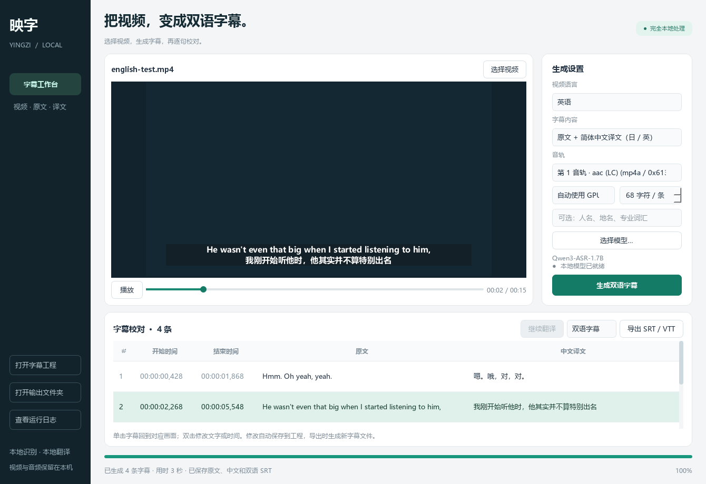
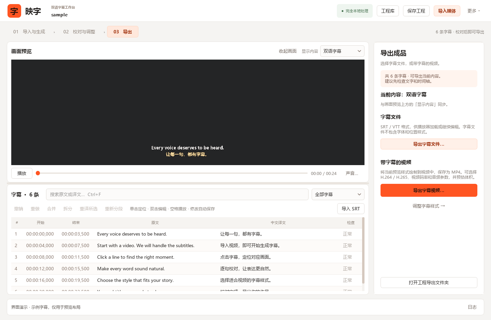
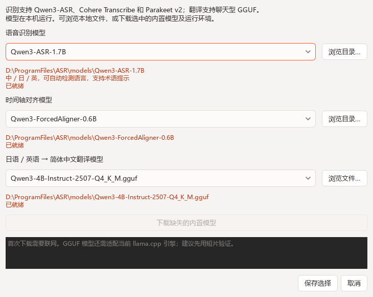

# 映字 · 本地双语字幕工作台

Windows 桌面应用：选择视频，在本机识别中文／日语／英语、对齐时间轴，将日语或英语翻译为简体中文，并预览、编辑、导出字幕。支持手动选择本地模型，也可接入 OpenAI 兼容的在线翻译 API。



## 首次安装

1. 在 Windows 上下载本仓库的 ZIP 并解压，或使用 Git 克隆仓库。
2. 安装 Python 3.12 或 uv；推荐 NVIDIA 显卡。识别也支持 CPU 模式。
3. 双击 `setup.cmd`，等待依赖、模型与翻译引擎下载完成。建议预留约 30 GB 磁盘空间。
4. 通过新建的桌面快捷方式启动应用。

仓库只包含源码、安装与测试脚本。模型权重、虚拟环境、运行时二进制、测试音视频和生成字幕均由脚本下载或运行时生成，不存入 Git。

## 开始使用

双击桌面的 **映字 - 双语字幕**，或此目录的 **启动映字.vbs**。

界面按 **导入与生成 → 校对与调整 → 导出** 组织。左侧是画面和字幕，右侧面板随顶部步骤切换为生成设置、字幕样式或导出。顶部显示当前媒体和本地／在线处理方式（绿色为完全本地，黄色表示字幕文本会发送至在线 API）；底部集中显示处理进度、取消入口和日志。尚未导入媒体时，左侧整栏都是导入区；“生成”按钮不可用时，按钮上方会说明原因。

1. 点击首页“导入视频或音频”或顶部“导入媒体”，也可直接拖入文件。可拖到预览区、字幕表或设置区；拖入只加载文件，不移动源文件。支持常见 MP4、MKV、MOV、AVI、WebM 等格式，也可以选择音频。
2. 在右侧“生成”页选择语言：自动识别，或手动指定“日语”“中文”“英语”。默认智能分割字幕，英文字幕保留空格与完整单词。音轨、运行设备、字幕分段和识别词汇提示收在“高级设置”中。
3. 保留“原文 + 简体中文翻译”，点击“生成双语字幕”。日语生成日中双语、英语生成英中双语，中文片段直接保留中文字幕；也可选择“仅原文字幕”，此时翻译设置自动收起。
4. 完成后单击字幕定位画面；双击修改文字或起止时间。修改原文会清空该条已有译文，点击“继续翻译”补全。焦点在字幕列表或画面上时，按空格播放／暂停。
5. 在字幕列表标题旁搜索原文或译文（Ctrl+F），可与“待翻译 / 待重试”“质量提示”筛选组合使用。选择一条字幕可拆分，选择连续多条可合并；也可右键字幕，从此条播放、拆分、合并或重译。不适用的操作自动禁用。“检查”列中需要处理的条目以彩色加粗显示。需要更多校对空间时，点击预览区“收起画面”。
6. 在“样式”页选择预设、字体和颜色；描边、阴影、底板和位置参数按组展开。可直接拖动画面中的字幕调整位置。
7. 在预览区上方“显示内容”选择双语、原文或中文，然后进入“导出”页。选择“导出字幕文件…”保存 SRT / VTT，或选择“导出字幕视频…”生成带字幕的 MP4。导出页会解释译文未完成、时间轴未完成或原媒体缺失的情况。



文档截图使用演示视频与示例字幕。

## 保存工程，下次继续编辑

与视频剪辑软件的工程类似，映字使用 **`.yingziproj` 工程文件** 保存视频关联、字幕原文与译文、时间轴、字幕样式、识别／翻译选项，以及视频与音频编码设置。导入媒体时就会创建工程，尚未生成字幕也能保存；修改会自动保存，关闭时再次保存。

- 顶部 **保存工程**（Ctrl+S）显示工程保存位置；**更多 → 另存工程…**（Ctrl+Shift+S）可自选名称与位置，后续修改保存到新文件。
- 下次点击 **打开工程**（Ctrl+Shift+O），或拖入 `.yingziproj` 工程文件，即可继续。重新打开会恢复播放位置、选中的字幕、当前步骤、搜索筛选及画面收起状态。
- 安装时会为当前 Windows 用户注册 `.yingziproj`，双击即可打开；已安装的用户可运行 `powershell -ExecutionPolicy Bypass -File tools\register_project.ps1` 注册。如果映字已启动，双击会把工程交给现有窗口。
- 原视频移动后，使用 **更多 → 重新关联原媒体…** 找到视频，保留字幕、样式与编码设置。工程同时记录相对路径，一起移动的工程与媒体可自动重新找到。

工程保存字幕和配置，引用原媒体文件，不复制大视频；这是映字自己的格式，不是 Adobe Premiere 的 `.prproj`。另存工程保留原工程和处理缓存，已有的识别／对齐进度仍可继续。缓存与日志保留在工程记录的输出文件夹；跨电脑搬迁时，需同时保留原媒体，需要继续处理或重新分段时也需携带该缓存文件夹，并重新选择本机可用的模型。撤销历史在本次打开期间保留。中断视频导出后可按已保存的编码设置重新导出，不能从已编码帧续接。

工程格式统一为 `.yingziproj`。旧 `.yingzi.json` 文件可运行 `.\.venv\Scripts\python.exe tools\migrate_projects.py output` 批量迁移，或将 `output` 换成具体工程文件／目录。工具会先验证全部旧工程，再在原文件夹中改名，逐个核对文件内容；不会覆盖已有新工程，字幕、样式、处理状态和缓存保持不变。可加 `--dry-run` 只检查。迁移完成后，原 `.yingzi.json` 文件不再保留。

播放器右侧的“声音…”可查看实际输出设备、调整预览音量和静音。默认跟随系统声音输出，运行中切换耳机或扬声器也会更新；可为本次使用手动指定设备，指定设备断开后回到系统默认。音量为零或静音时，按钮显示“已静音…”。

已有 SRT 时，先载入视频，再点击字幕列表的“导入 SRT”，或把 `.srt` 拖到预览区、字幕表或设置区即可导入，随后可以编辑文字、调整字幕样式、导出字幕或合成视频。导入不会启动识别或在线翻译，当前视频保持不变。拖放按扩展名区分媒体、SRT 和映字工程；文本文件、图片、可执行文件等不会被当成视频载入。

SRT 支持 UTF-8（含 BOM）、带 BOM 的 UTF-16，以及 GB18030／常见中文 ANSI 编码。保留时间轴和多行文本，整条文字放入“原文”列，并自动切到“原文字幕”预览与导出；不把第二行猜成译文。基础 HTML 样式标签转换为纯文本，外观由“字幕样式”控制。字幕语言按其文字判断，不直接沿用视频的识别语言。

每次导入另存一个字幕工程，源 SRT 和原有工程保留；导入可撤销、重做，后续编辑自动保存到新工程。空字幕、无效时间或重叠时间段会提示错误并保留当前内容；目前编辑器要求字幕时间段不重叠。

选项框通过下拉列表选择。分段方式默认“智能分割”，也可手动选择每条 16～100 字符。鼠标滚轮只滚动设置页面或展开的列表，不会修改当前选项、数值或播放进度；即使控件已经获得焦点也不会误改。

支持外挂字幕文件及将字幕烧录到画面的 MP4 视频。视频导出可选择 H.264 / H.265、视频码率及音频参数；后台显示进度，支持取消。导出采用临时文件，成功后才替换目标文件，不能覆盖原视频。

## 智能分割

智能分割结合原文标点、对齐后的语音停顿，以及中日英的连接词、助词等规则，在每个语音片段内比较不同分段方案，平衡字幕长度和显示时长。优先在句子、分句或停顿处分开，减少句尾只剩一两个字、英文单词或数字与单位被拆开的情况。较短的完整句子可以超过原来的 30 字限制；较长内容会继续分段，明显停顿保持分开。

通常每条不超过 6 秒；中日文按显示宽度控制在约 44 个全角字符以内，英语不超过 112 字符。无法继续拆开的单个对齐词可能超出这些范围，以保留全文及真实时间戳。字幕在画面中的换行仍由“字幕样式”的最大行宽控制。

这是本机规则算法，不调用大模型，也不额外产生 API 费用，不能保证每次都准确理解句意。新生成的工程保留对齐缓存，修改分段选项后可点击“重新分段”，无需重新识别、对齐或调用翻译 API；完全相同的字幕保留译文，改变了边界的字幕需要继续翻译。已人工修改原文时会阻止重新分段，避免覆盖校对结果；没有对齐缓存的旧工程需要重新生成。新工程保存分段方式，旧工程保留原来的固定字符数设置。

## 校对、恢复与进度

- 按住 Ctrl / Shift 选择多行，可对选中条目重新翻译；连续、同语言字幕可以合并，也可以在选定文字与时间位置拆分。修改原文、合并和拆分会清空受影响条目的译文。
- 点击字幕后显示附近音频波形，拖动两侧时间标记调整起止点，边界不会越过相邻字幕。文字、时间轴及合并／拆分支持撤销和重做，历史在本次打开工程期间保留。
- “检查”列提示待翻译、翻译失败、阅读速度过快、显示时间过短或过长、文字过长及可疑重复译文，可筛选待处理项；提示用于辅助校对，不会自动删除或改写字幕。
- 识别和对齐每完成一个语音片段即保存缓存。失败或取消后打开工程，点击“继续处理”，只处理尚未完成的片段。源文件、音轨、语言、识别提示或模型路径改变时，会拒绝套用旧缓存。
- 翻译成功的批次会立即显示并保存。界面显示成功／待重试条数、请求次数、服务返回的 Token 用量、耗时和估计剩余时间；估计时间会随重试与响应速度变化。

在“生成”页的“术语与风格”中填写人名对照、术语及表达风格，随工程保存。后续请求会包含这些要求以及已经完成的相邻译文参考；并发请求只能引用提交时已有的译文。要求不会自动重译已有字幕，需要使用“重译所选”。在线模式会把这些文字发送给配置的服务。

## 字幕样式与视频导出

- 字体、粗体、斜体、下划线；原文与译文分别设置字号、颜色。
- 描边粗细与颜色、阴影距离与颜色、整体不透明度。
- 背景颜色、不透明度、内边距、圆角；最大行宽、自动换行、行距与对齐方式。
- 在预览画面中直接拖动字幕；也可以调整水平中心、底边百分比和旋转角度，或使用快速定位和样式预设。拖动时暂停播放，字幕位置限制在视频画面内。
- 样式应用于全部字幕并自动保存在工程中，重新打开时恢复。空白时段可以显示示例字幕供调整，示例不会进入成片。

预览与导出共用 Qt 字体排版和图层绘制，中文、日文、特殊字符、换行及样式保持一致。字号和间距以画面高 720 为基准等比缩放；位置按实际视频画面计算，不包含播放器留白。支持竖屏、旋转标记和非方形像素的视频。导出可保持原始显示分辨率，或缩小到 1920×1080 / 1280×720 范围内，不放大小视频。

字幕表上方的“双语字幕 / 原文字幕 / 中文字幕”同时控制预览、字幕文件与视频导出。译文未完成时可先导出原文；时间轴未完成的工程需要先重新生成字幕。SRT / VTT 不保存这些视觉样式，视频导出会固定字幕外观。

导出设置分别提供视频编码格式和编码设备：H.264 兼容性较好，H.265 / HEVC 压缩效率较高但需要播放器支持。设备默认自动检测可用的 NVIDIA NVENC，也可手动选择 NVIDIA 或 CPU。硬件编码不可用或失败时回退同一格式的 CPU 编码，并保留码率和音频设置。

- **跟随源文件（默认）**：参考源视频平均码率，并扣除输出音频需要的体积预算，减少高画质重编码造成的体积膨胀。源视频未标注码率时按文件大小、时长和音轨估算；无法估算时需选择自定义码率或恒定画质。
- **自定义平均码率**：输入视频码率（kbps），实时查看预计文件大小。估算包含所选音轨和少量封装开销；多音轨的音频码率累加，实际体积随画面复杂度、音轨时长及编码器浮动，并非严格大小上限。
- **恒定画质**：提供高画质、均衡、较小文件三个档位；不限制码率，成片可能明显大于源文件。跟随源码率也不保证相同画质，字幕较复杂或转换编码格式时可提高自定义码率。
- **音频**：默认自动复制 MP4 兼容音轨（AAC / MP3 / AC-3 / E-AC-3 / ALAC），其余转为 AAC。也可选择直接复制、全部 AAC 转码或无音频；保留全部音轨或指定任一音轨。AAC 支持每轨 64～320 kbps、保持原采样率或 44.1 / 48 kHz、保持原声道或转单声道 / 立体声。直接复制保持原音频参数。

导出弹窗显示源文件大小、视频编码、码率、时长和音轨数，导出设置随工程保存。字幕图层仍在 CPU 上绘制，速度受分辨率、时长、样式和编码设置影响。图层临时 PNG 在结束或取消后清理。当前输出为 8 位视频，不提供 HDR 保真导出；纯音频仍使用字幕文件导出。

## 在线大模型翻译 API

1. 在右侧“生成”页先选择“在线 API · 联网翻译”，再点击 **API 设置**，填写服务商的 Base URL、模型 ID 和 API 密钥。地址可以包含 `/v1`、服务商的兼容接口前缀，或直接填写完整的 `/chat/completions` 地址。
2. 每组默认最多 **10 条字幕**，可在“每组字幕”下拉框选择 1～20 条；选择 1 条可使用逐条翻译。点击 **测试翻译** 会向当前服务发送最多三条固定英文示例，并验证译文与字幕编号；此操作可能产生少量 API 费用，不发送当前视频字幕。
3. 点击 **保存并使用在线翻译**。生成双语字幕或打开已有工程点击“继续翻译”，即可使用该接口；下拉框可随时切回本地模型翻译。

在线模式将一组连续字幕放入同一次请求，并附带组外前后各三条原文（前后分别最多 600 个字符）。提示词要求先理解整段对白、统一称呼和术语，再按原编号逐条返回译文，保持原文和时间轴。遇到语言切换、至少 3 秒的停顿、已完成条目的空档，或组内原文超过 1800 字符时提前分组；单条过长原文会单独发送。

每个成功批次立即保存工程。若结果漏号、重复编号、空译文、只有标点、JSON 无效或输出截断，会把当前批次对半拆分重试，必要时退回逐条；单条仍失败时记录错误并继续后面的字幕。连接超时、断连、域名解析失败或响应接收中断会等待 1 秒、2 秒后重试同一组，每次请求最多尝试 3 次；不因连接错误拆分字幕。认证、证书校验错误或重试后仍失败时停止派发新请求，保存已收到的结果。出错、取消后再次“继续翻译”只处理缺少译文或标记失败的条目。识别和时间轴对齐仍在本机运行，不需要本地 GGUF 翻译模型及 llama.cpp。

默认最多同时执行 2 个请求、每分钟最多启动 60 次请求，可在 API 设置中调整并发数 1～4 及速率；每分钟设置为 0 表示不主动限速。拆分和重试也经过同一个限速队列。并发可降低等待时间，术语表有助于各组保持一致。

“思考模式”默认自动：仅对 DeepSeek 官方地址的 `deepseek-flash`、`deepseek-v4-flash`、`deepseek-v4-pro` 发送关闭思考参数，避免思考消耗输出预算而没有译文。其他模型和地址不额外发送此参数。可以切回“服务默认”，或为支持 `thinking` 参数的接口手动开启／关闭。参考 [DeepSeek 思考模式说明](https://api-docs.deepseek.com/zh-cn/guides/thinking_mode/)。

接口使用 Bearer API Key 和 Chat Completions 协议。默认“自动兼容”先请求 JSON Object；服务明确不支持该参数时改用提示词约束 JSON。还可指定 JSON Schema 或仅提示词模式，以及超时、输出 Token 上限、`max_tokens` / `max_completion_tokens` 参数。服务端需要支持 `system` / `user` 消息，并在 `choices[].message.content` 返回文本；其他原生协议需要使用服务商的 OpenAI 兼容入口。

密钥通过当前 Windows 用户的 DPAPI 加密保存在本机 `settings.json`，与填写的 API 地址绑定；不能直接拷贝到其他账户使用。API 地址、密钥、模型配置由本机管理，字幕工程只记录本地／在线翻译方式，导入工程不会替换本机 API 地址。更换接口地址后需为新地址填写密钥。密钥不会写入字幕工程、处理任务 JSON 或运行日志，可在设置中清除。

在线请求使用系统网络代理设置；外部服务要求 HTTPS，HTTP 仅允许本机回环地址。遇到限流或临时服务错误会有限重试；认证错误直接提示，重定向不会转发密钥。第三方接口的计费、额度和可用模型由服务商决定。

协议参考：[Chat Completions](https://developers.openai.com/api/reference/resources/chat/subresources/completions/methods/create)、[JSON 输出格式](https://developers.openai.com/api/docs/guides/structured-outputs?api-mode=chat)。

## 手动选择模型

在右侧“生成”页底部点击 **管理模型**：

- **语音识别**：选择 Qwen3-ASR-1.7B（默认）、Qwen3-ASR-0.6B、Cohere Transcribe 2B 或 Parakeet TDT 0.6B v2。也可浏览这些架构的兼容本地模型目录。
- **时间轴对齐**：默认 Qwen3-ForcedAligner-0.6B；可浏览兼容的本地对齐模型目录。
- **字幕翻译**：选择 `models/` 中的 GGUF，或浏览其他路径的聊天型 GGUF 文件。模型需要支持中日英翻译、JSON 输出，并能由当前 llama.cpp 引擎加载；任意 GGUF 并不保证兼容。

| 识别模型 | 语言和用途 | 说明 |
| --- | --- | --- |
| Qwen3-ASR 1.7B / 0.6B | 中日英通用 | 支持自动检测语言和术语提示 |
| Cohere Transcribe 2B | 日语候选，也支持中英 | 必须手动指定语言；不支持术语提示 |
| Parakeet TDT 0.6B v2 ONNX | 英语快速识别 | 必须选择英语；不支持术语提示 |

三个引擎都通过所选 Qwen3-ForcedAligner 生成字幕起止时间，再使用所选 GGUF 翻译。Parakeet 原生 token 时间戳也保存在 `recognition.json`，目前字幕分句采用统一的强制对齐结果。长视频先用 VAD 切成不超过 24 秒的语音片段，识别引擎释放后再加载对齐和翻译模型。



窗口会显示路径与文件检查结果。内置模型缺失时，点击“下载缺失的内置模型”，完成后点击“保存选择”。首次安装默认下载 1.7B；0.6B 按需下载，权重约 1.9 GB。取消下载会保留可续传文件。本地外部模型无需映字专用的 `.complete` 标记。

Cohere 权重约 4.1 GB，Parakeet ONNX 文件约 2.5 GB。扩展环境另需 PyTorch CUDA 和其他依赖，安装全部模型建议再预留约 20 GB 空间。Cohere 官方仓库需要先在 [模型页](https://huggingface.co/CohereLabs/cohere-transcribe-03-2026) 接受访问条件，并在终端执行 `.\.venv\Scripts\hf.exe auth login`；令牌由 Hugging Face CLI 保存，不应写入工程、Git 或聊天。模型下载器使用该本机登录，并在跳转到其他下载域名时移除授权头。

选择保存在本机 `settings.json`，重启后保留。每个字幕工程也记录模型路径及生成选项，打开时恢复；如工程来自其他电脑，重新选择有效的本地路径即可。处理过程中不能切换模型；更换模型后用于下一次生成或“继续翻译”，已完成的译文保留。

## 文件与模型

每次处理创建独立 `output/视频名_日期时间_编号/` 文件夹，包含：

- `bilingual.srt`：日文或英文在上、中文在下，共用同一时间轴。
- `original.srt`、`translated.srt`：原文和中文版本。
- `bilingual.vtt`：WebVTT 双语字幕。
- `.yingziproj`：可再次打开编辑的映字工程；命令行处理默认生成 `subtitles.yingziproj`。另存到自选位置后，工程会记录原输出文件夹的位置。
- `recognition.json`：识别原始结果；`run.log`：运行日志。
- `.pipeline/`：提取的音频、逐片段识别和原始对齐缓存，用于继续处理和重新分段。缓存会占用磁盘；项目完成且不再需要恢复或重新分段时可以删除该目录，保留工程和字幕文件。
- `api-diagnostics.jsonl`：在线请求的编号、模型、结束原因、输出／推理字符数、Token 用量、耗时与重试次数。网络错误另记连接／读取阶段、错误类别、系统错误码和重试等待时间；不会记录密钥、代理凭据、提示词、原文正文或模型思考文本。日志可从“日志”窗口查看。

编辑会自动保存字幕工程；已经导出的 SRT 不会自动更新，需要再次导出。翻译失败或取消时，已经保存的原文与字幕工程仍然保留。“继续翻译”只处理缺少译文或标记失败的日语／英语字幕。部分翻译完成时，自动生成的字幕文件会使用原文填补缺失译文；界面仍提示待重试，双语或中文的完整导出需先补齐翻译。

本地翻译逐条生成，沿用每组八条内的原文上下文；在线翻译默认成组生成，并附带组外前后三条原文。输出会检查编号覆盖、有效文字和完整格式，但无法仅凭这些检查判断模型是否把含义挪到了相邻字幕，仍需结合播放画面校对。

内置模型保存在本目录的 `models/`，推理只加载本地文件：

| 用途 | 模型 | 来源 |
| --- | --- | --- |
| 中日英语音识别 | Qwen3-ASR-1.7B / 0.6B | https://github.com/QwenLM/Qwen3-ASR |
| 中日英语音识别 | Cohere Transcribe 2B，Apache 2.0 | https://huggingface.co/CohereLabs/cohere-transcribe-03-2026 |
| 英语语音识别 | NVIDIA Parakeet TDT 0.6B v2，CC-BY-4.0；使用 istupakov 的 ONNX 转换 | https://huggingface.co/istupakov/parakeet-tdt-0.6b-v2-onnx |
| 时间轴 | Qwen3-ForcedAligner-0.6B | https://huggingface.co/Qwen/Qwen3-ForcedAligner-0.6B |
| 日中 / 英中翻译 | Qwen3-4B-Instruct-2507，Q4_K_M | https://huggingface.co/unsloth/Qwen3-4B-Instruct-2507-GGUF |

语音检测使用 Silero VAD；音轨提取使用 imageio-ffmpeg 自带的 FFmpeg；翻译由 llama.cpp 的 Windows CUDA 引擎运行。第三方项目遵循各自许可证。模型下载脚本会验证大文件 SHA-256，并记录仓库修订版本。

识别、对齐、翻译分阶段加载。自动模式优先使用 NVIDIA GPU，Qwen 支持显存不足时部分权重放入内存；Cohere 和 Parakeet 需容纳所选精度的权重及运行开销，也可以选择“CPU 兼容”。速度会受显存占用和视频时长影响。

## 安装与修复

应用使用本目录 `.venv` 中的 Python 3.12 环境。双击 `setup.cmd` 可以重新安装依赖并续传模型。安装脚本使用 `requirements-lock.txt` 固定已验证的依赖版本。需要 Python 3.12 或已安装的 uv；运行环境与模型初次安装需要联网。选择本地翻译时，安装后识别和翻译不访问外部服务；选择在线 API 时，字幕文本会发送至所配置的服务。

Cohere 和 Parakeet 使用独立的 `runtime/asr-env`，由 `requirements-extra.txt` 声明依赖，安装时使用 `requirements-extra-lock.txt` 固定已验证版本，避免升级主环境的 Transformers 4。新引擎在子进程运行，取消任务会终止整个任务进程树；子进程报错时不会把部分识别结果标记为完成。

```powershell
.\.venv\Scripts\python.exe tools\download_assets.py extra-runtime parakeet cohere
.\.venv\Scripts\python.exe tools\run_validation.py --languages english --asr-model models/parakeet-tdt-0.6b-v2-onnx
.\.venv\Scripts\python.exe tools\run_validation.py --languages japanese english --asr-model models/cohere-transcribe-03-2026
```

```powershell
.\.venv\Scripts\python.exe main.py
.\.venv\Scripts\python.exe -m pytest -q
```

需要运行真实模型流程检查时，执行下列命令；脚本会先下载下文列出的公开测试音频，再在 `output/` 生成验证字幕：

```powershell
.\.venv\Scripts\python.exe tools\run_validation.py
.\.venv\Scripts\python.exe tools\smoke_ui_flow.py
```

单独检查英语或 0.6B 模型：

```powershell
.\.venv\Scripts\python.exe tools\download_assets.py asr-small
.\.venv\Scripts\python.exe tools\run_validation.py --languages english --asr-model models/Qwen3-ASR-0.6B
.\.venv\Scripts\python.exe tools\smoke_ui_flow.py output/验证_英中双语_Qwen3-ASR-0.6B/subtitles.yingziproj
```

翻译引擎仅监听随机端口的 `127.0.0.1`，使用每次启动随机生成的 API 密钥；任务结束后关闭。原始媒体不会被上传。

## 使用范围

当前按普通对白设计。背景音乐很重、多人同时说话、含糊发音、人名和专有名词仍可能识别错误；选择 Qwen 时，在“人名、地名、专业词汇”中填写提示可帮助识别。自动字幕与译文建议在导出前校对。

## 验证素材来源

- 日语：Kotoba-Whisper v2.2 模型仓库的 `sample_audio/sample_diarization_japanese.mp3`，默认取前 16 秒合成测试视频；Cohere 本机验证使用完整 26.63 秒样本。
- 中文：Qwen3-ASR 官方演示音频 `https://qianwen-res.oss-cn-beijing.aliyuncs.com/Qwen3-ASR-Repo/asr_zh.wav`。
- 英语：Qwen3-ASR 官方演示音频 `https://qianwen-res.oss-cn-beijing.aliyuncs.com/Qwen3-ASR-Repo/asr_en.wav`，取前 16 秒合成测试视频。

这些短片仅用于功能验证，不代表识别精度或速度基准。
